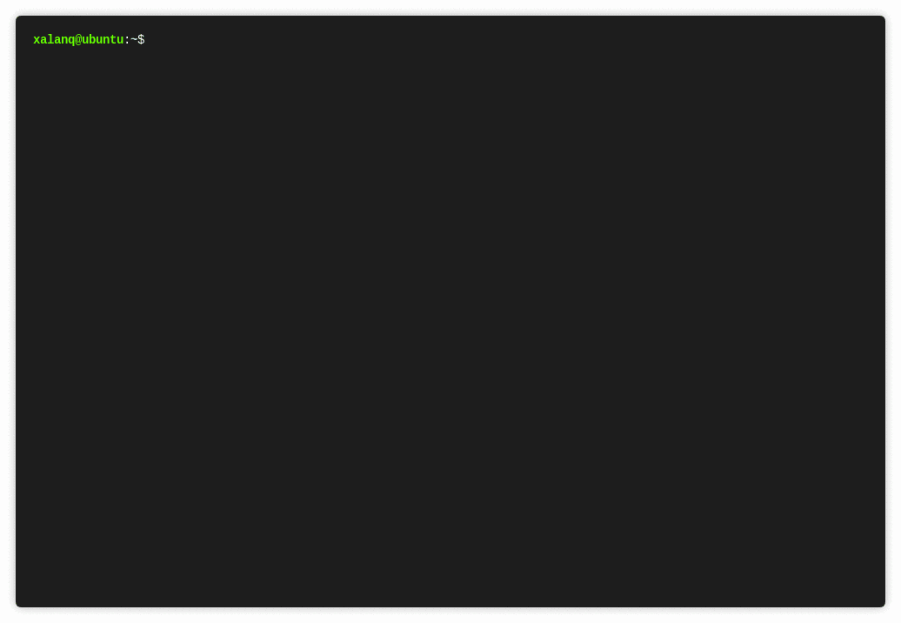

# Codeforces Tool

[](https://github.com/cys001x/cf-tool-x/releases)
[](https://github.com/cys001x/cf-tool-x/releases)
[](https://github.com/cys001x/cf-tool-x/actions/workflows/build.yml)
[](https://goreportcard.com/report/github.com/cys001x/cf-tool-x)
[](https://go.dev)
[](https://github.com/cys001x/cf-tool-x/blob/main/LICENSE)

Codeforces Tool x is a command-line interface tool for [Codeforces](https://codeforces.com).

It's fast, small, cross-platform and powerful.

[Installation](#installation) | [Usage](#usage) | [Commands](./docs/commands.md) | [FAQ](#faq) | [中文](./README_zh_CN.md)

## Features

* Support Contests, Gym, Groups and acmsguru.
* Support all programming languages in Codeforces.
* Submit codes.
* Watch submissions' status dynamically.
* Fetch problems' samples.
* Sync a contest or a problem in one command: samples, statements, and the latest submission code.
* Time a contest or a problem and record every time node.
* Query timer data with SQL, totals, and date-range statistics.
* Generate random practice sets from local history or the Codeforces problemset.
* Compile and test locally.
* Clone all codes of someone.
* Generate codes from the specified template (including timestamp, author, etc.)
* List problems' stats of one contest.
* List the 20 most recent contests with links and divisions.
* Use default web browser to open problems' pages, standings' page, etc.
* Setup a network proxy. Setup a mirror host.
* Colorful CLI.

Pull requests are always welcome.



## Installation

You can download the pre-compiled binary file in [here](https://github.com/cys001x/cf-tool-x/releases).

Then enjoy the cf-tool~

Or you can compile it from the source **(go >= 1.26)**:

```plain
$ git clone https://github.com/cys001x/cf-tool-x.git
$ cd cf-tool-x
$ go build -ldflags "-s -w" cf.go
```

If you use the Go module proxy and the repository is private, tell Go to fetch it directly:

```plain
$ go env -w GOPRIVATE=github.com/cys001x/cf-tool-x
```

## Usage

See [docs/commands.md](./docs/commands.md) for the full command reference,
including `cf sync`, `cf pull`, and `cf clone`.

Let's simulate a competition.

 `cf race 1136` or `cf race https://codeforces.com/contest/1136`

To start competing the contest 1136!

If the contest has not started yet, `cf` will count down. If the contest have started or the countdown ends, `cf` will use the default browser to open dashboard's page and problems' page, and fetch all samples to the local.

 `cf sync 1136` or `cf sync 1136a`

Sync a whole contest or a single problem in one command: fetch samples and statements, pull your latest submission code, or generate a code from the default template when there is no submission and no local code. If local code already exists, `cf` asks before overwriting it.

 `cf timer`

Open the global timer. It refreshes the elapsed time on one line every second.
Type `start <specifier> <note>` to start timing a problem or contest, `end
<specifier> <note>` to stop it, `pause` to pause or resume, and `q` (or `exit`) to close
the timer and print the summary. The same commands work from any other terminal,
so the timer state can be updated from any terminal. There is no background
daemon: the clock is derived from timestamps in `~/.cf/timer.json`.

While the timer is open, every other `cf` command can be typed without the `cf`
prefix, for example `submit 1136a`. It runs below the timer and the timer stays
open afterwards; `timer` itself is rejected. Ctrl-C or Ctrl-D leaves the timer
running in the background.

Several problems can be timed at the same time; `end` closes the one matching
the specifier. `cf test` records a `test` node when every sample passes, and `cf submit`
records a `submit` node with the verdict. An accepted submission asks whether to
close the timer and, if yes, asks for a summary of the session. Nodes are saved
in `<problem>/count_time.json`; the singleton state lives in
`~/.cf/timer.json`. The note of `end`, or the summary typed at `q`, is stored
as the `summary` field of that problem's record.

 `cf db sync`

Build the local SQLite index from the timer records and fetch contest
metadata. `cf db time 1136a` prints the time nodes and total time of a problem;
`cf db time 1136` prints per-problem totals for a contest. `cf db stats
--from 2026-01-01 --to 2026-06-30` counts the problems completed in a range,
with a per-day breakdown; add `--accepted` to keep only accepted problems.
`cf db sql "SELECT ..."` runs read-only SQL against `~/.cf/timer.db`, and
`--write` allows changes. Each problem also gets one derived status label
(`pending`, `open`, `done`, `tests_passed`, `accepted`). Accepted submits made
during a practice timing run (`cf timer s p_<set> <problem>`) change it to
`practice_1`, `practice_2`, and so on up to `practice_9`. `cf db stats --status
done` filters by status.

 `cf lpractice 5`

Pick 5 random problems from the local timer database and create the practice
set under `cf/practice/<timestamp>-practice`. Each problem gets its samples,
`statement.md`, and a code file from the default template. `cf lrepractice`
picks only accepted problems, including ones accepted again in practice
(`practice_N`); `cf lnrepractice` picks only problems never
timed. Add a second argument to name the folder, for example `cf lpractice 5
drill`. `cf opractice 5 --difficulty 1200-1600 --tags dp,greedy` selects from
the online Codeforces problemset instead. Start a practice run with
`cf timer s p_drill 1136a "retry"`; accepted submits during that run advance
the problem's practice label.

A practice problem can also be used as one specifier, `p_<set>_<problem>`:
`cf submit p_drill_1136a` submits the code in `cf/practice/drill/1136a`,
`cf test p_drill_1136a` tests it, and `cf timer s p_drill_1136a` starts the
practice run. Use it as the only specifier. The problem part is the practice
folder name (`1136a`, `100001a`), so set names may contain underscores
(`p_drill_easy_1136a`).

 `cd ./cf/contest/1136/a` (May be different from this, please notice the message on your screen)

Enter the directory of problem A, the directory should contain all samples of the problem.

 `cf gen` 

Generate a code with the default template. The filename of the code is problem id by default. An empty `analysis.md` is created next to it.

 `vim a.cpp` 

Use Vim to write the code (It depends on yourself).

 `cf test` 

Compile and test all samples.

 `cf submit` 

Submit the code.

 `cf list` 

List problems' stats of the contest.

 `cf ncontests`

List the 20 most recent finished contests with their link, division, and name.

 `cf stand` 

Open the standings' page of the contest.

```plain
You should run "cf config" to configure your handle, password and code
templates at first.

If you want to compete, the best command is "cf race"

Usage:
  cf config
  cf submit [-f <file>] [<specifier>...]
  cf list [<specifier>...]
  cf ncontests
  cf parse [<specifier>...]
  cf gen [<alias>]
  cf test [-f <file>] [-d <dir>] [<specifier>...]
  cf watch [all] [<specifier>...]
  cf open [<specifier>...]
  cf stand [<specifier>...]
  cf sid [<specifier>...]
  cf detail [<specifier>...]
  cf race [<specifier>...]
  cf pull [ac] [<specifier>...]
  cf sync [<specifier>...]
  cf timer [<args>...]
  cf db [options] [<args>...]
  cf lpractice [options] <count> [<name>]
  cf lrepractice [options] <count> [<name>]
  cf lnrepractice [options] <count> [<name>]
  cf opractice [options] <count> [<name>]
  cf clone [ac] [<handle>]
  cf statement [<specifier>...] [-d <dir>] [-f <file>]
  cf material [<specifier>...] [-d <dir>] [-f <file>]
  cf completion [<shell>]
  cf upgrade

Options:
  -h --help            Show this screen.
  --version            Show version.
  -f <file>, --file <file>, <file>
                       Path to file. E.g. "a.cpp", "./temp/a.cpp"
                       Download file name.
  -d <dir>, --dir <dir>
                       Path to directory containing sample files for cf test.
                       Download file Path.
  <specifier>          Any useful text. E.g.
                       "https://codeforces.com/contest/100",
                       "https://codeforces.com/contest/180/problem/A",
                       "https://codeforces.com/group/Cw4JRyRGXR/contest/269760"
                       "1111A", "1111", "a", "Cw4JRyRGXR"
                       "p_drill_1136a" means problem 1136a in
                       "{cf}/practice/drill" (a practice set created by
                       "cf lpractice"/"cf opractice").
                       You can combine multiple specifiers to specify what you
                       want.
  <alias>              Template's alias. E.g. "cpp"
  <shell>              Shell to generate completion for: bash, zsh or fish.
  <args>               Timer commands (start/end/pause/q/status, or s/e/p/q) or
                       db commands (sql/time/stats/sync/path) and arguments.
  ac                   The status of the submission is Accepted.
  --from <date>        Start date (YYYY-MM-DD) for "cf db stats".
  --to <date>          End date (YYYY-MM-DD) for "cf db stats".
  --status <status>    Keep only pending/open/done/tests_passed/accepted/
                       practice_N in "cf db stats".
  --accepted           Only count accepted problems in "cf db stats".
  --refresh            Refresh contest metadata in "cf db sync".
  --write              Allow writes in "cf db sql".
  -j, --json           Print JSON in "cf db".
  --difficulty <range> Problem rating for "cf opractice": "1200" or "800-1200".
  --tags <tags>        Comma-separated Codeforces tags for "cf opractice".
  <count>              Number of problems in the practice set.
  <name>               Practice folder name. Default "<timestamp>-practice".

Examples:
  cf config            Configure the cf-tool.
  cf submit            cf will detect what you want to submit automatically.
  cf submit -f a.cpp
  cf submit https://codeforces.com/contest/100/A
  cf submit -f a.cpp 100A 
  cf submit -f a.cpp 100 a
  cf submit contest 100 a
  cf submit gym 100001 a
  cf submit 1136a      Print the link right after submitting, and when the
                       verdict is not accepted, print the failed tests and
                       save them as inK.txt/ansK.txt for "cf test".
  cf list              List all problems' stats of a contest.
  cf list 1119
  cf ncontests         List the 20 most recent finished contests with their
                       link, division and name.
  cf parse 100         Fetch all problems' samples of contest 100 into
                       "{cf}/{contest}/100/<problem-id>".
  cf parse gym 100001a
                       Fetch samples of problem "a" of gym 100001 into
                       "{cf}/{gym}/100001/a".
  cf parse gym 100001
                       Fetch all problems' samples of gym 100001 into
                       "{cf}/{gym}/100001".
  cf parse             Fetch samples of current problem into current path.
  cf gen               Generate a code from default template and create an
                       empty analysis.md next to it.
  cf gen cpp           Generate a code from the template whose alias is "cpp"
                       into current path.
  cf test              Run the commands of a template in current path. Then
                       test all samples. If you want to add a new testcase,
                       create two files "inK.txt" and "ansK.txt" where K is
                       a string with 0~9.
  cf test -f a.cpp -d ./1a  Test a.cpp using sample files from directory ./1a.
  cf watch             Watch the first 10 submissions of current contest.
  cf watch all         Watch all submissions of current contest.
  cf open 1136a        Use default web browser to open the page of contest
                       1136, problem a.
  cf open gym 100136   Use default web browser to open the page of gym
                       100136.
  cf stand             Use default web browser to open the standing page.
  cf sid 52531875      Use default web browser to open the submission
                       52531875's page.
  cf sid               Open the last submission's page.
  cf detail https://codeforces.com/contest/1136/submission/52531875
                       Print the summary and the per-test results of a
                       submission, including input/output of failed tests.
  cf detail            Print the details of the last submission.
  cf race 1136         If the contest 1136 has not started yet, it will
                       countdown. When the countdown ends, it will open all
                       problems' pages and parse samples.
  cf pull 100          Pull all your submissions of contest 100 into
                       "./<problem-id>/<problem-id>.<ext>".
  cf pull 100 a        Pull your submissions of problem "a" of contest 100
                       into "./a.<ext>".
  cf pull ac 100 a     Pull the "Accepted" or "Pretests passed" code of problem
                       "a" of contest 100.
  cf pull              Pull your submissions of the current problem into the
                       current path.
  cf sync 1136         Sync all problems of contest 1136: fetch samples and
                       statements, pull the latest submission code, or
                       generate a code from the default template when there is
                       no submission and no local code.
  cf sync 1136a        Sync problem "a" of contest 1136.
  cf sync              Sync the current problem.
  cf timer             Open the timer in the foreground. Every second it
                       refreshes the elapsed time on one line. There is no
                       background daemon: the state lives in
                       "~/.cf/timer.json" and commands work from any terminal.
                       While the timer is open, any other cf command can be
                       typed without "cf" and runs below the timer, for
                       example "submit 1136a". The timer stays open.
  cf timer start 1136a "read the problem"
                       Start timing problem "a" of contest 1136.
  cf timer end 1136a "solved"
                       End the running problem. It must match the start.
  cf timer pause       Pause or resume the timer.
  cf timer q "contest done"
                       Close the timer and print the summary. "q" can also
                       be written as "exit"; commands can be shortened to their
                       first letter: s, e, p, q. The same commands work from
                       any terminal while the timer is open.
  cf timer s p_drill 1136a "practice"
                       Start a practice run for problem 1136a in the set
                       "{cf}/practice/drill". Accepted submits in this run
                       advance the practice label. "p_drill_1136a" can be
                       used instead of "p_drill 1136a".
  submit 1136a         (inside cf timer) Run "cf submit 1136a" without leaving
                       the timer. Every cf command except "timer" works this
                       way; typing "q" closes the timer.
  cf submit p_drill_1136a
                       Submit the code of practice problem 1136a in
                       "{cf}/practice/drill". "p_<set>_<problem>" works
                       wherever a specifier is accepted, and starts a
                       practice run in "cf timer start/end".
  cf db sync           Index every "count_time.json" into "~/.cf/timer.db"
                       and fill contest metadata from the Codeforces API.
  cf db time 1136a     Print the time nodes and total time of a problem.
  cf db time 1136      Print per-problem totals, sum and span of a contest.
  cf db stats --from 2026-01-01 --to 2026-06-30
                       Count problems completed in a date range.
  cf db stats --accepted --from 2026-01-01
                       Count only completed problems with an accepted submit.
  cf db stats --status done --from 2026-01-01
                       Count only problems whose derived status is "done".
  cf db sql "SELECT type, COUNT(*) FROM event GROUP BY type"
                       Run a read-only SQL query. Add --write to modify data.
  cf lpractice 5       Pick 5 random problems from the local timer database.
  cf lrepractice 5     Pick 5 random accepted problems from the local database.
  cf lnrepractice 5    Pick 5 random problems never timed locally.
  cf opractice 5 --difficulty 1200-1600 --tags dp,greedy
                       Pick 5 random Codeforces problemset problems.
  cf lpractice 5 drill Create "cf/practice/drill" instead of a timestamped
                       folder.
  cf clone xalanq      Clone all codes of xalanq.
  cf statement         Fetch problem statement of current problem as statement.md.
  cf statement 1136a   Fetch statement of contest 1136 problem a.
  cf statement 1136    Fetch all statements of contest 1136.
  cf material 1136     Fetch all Contest materials for contest 1136 and save as .md files.
  cf completion bash   Print a bash completion script. Load it with
                       "source <(cf completion bash)".
  cf completion zsh    Print a zsh completion script. Load it with
                       "eval \"$(cf completion zsh)\"" in ~/.zshrc.
  cf completion fish   Print a fish completion script. Save it to
                       "~/.config/fish/completions/cf.fish".
  cf upgrade           Upgrade the "cf" to the latest version from GitHub.

File:
  cf will save some data in some files:

  "~/.cf/config"        Configuration file, including templates, etc.
  "~/.cf/session"       Session file, including cookies, handle, password, etc.
  "~/.cf/timer.json"     State of the global timer.
  "~/.cf/timer.db"       Local SQLite index of the timer records.
  "<problem>/count_time.json"
                        Timer data written by "cf timer".
  "{cf}/practice/<name>"
                        Practice sets created by "cf lpractice" and "cf opractice".

  "~" is the home directory of current user in your system.

Template:
  You can insert some placeholders into your template code. When generate a code
  from the template, cf will replace all placeholders by following rules:

  $%U%$   Handle (e.g. xalanq)
  $%Y%$   Year   (e.g. 2019)
  $%M%$   Month  (e.g. 04)
  $%D%$   Day    (e.g. 09)
  $%h%$   Hour   (e.g. 08)
  $%m%$   Minute (e.g. 05)
  $%s%$   Second (e.g. 00)

Script in template:
  Template will run 3 scripts in sequence when you run "cf test":
    - before_script   (execute once)
    - script          (execute the number of samples times)
    - after_script    (execute once)
  You could set "before_script" or "after_script" to empty string, meaning
  not executing.
  You have to run your program in "script" with standard input/output (no
  need to redirect).

  You can insert some placeholders in your scripts. When execute a script,
  cf will replace all placeholders by following rules:

  $%path%$   Path to source file (Excluding $%full%$, e.g. "/home/xalanq/")
  $%full%$   Full name of source file (e.g. "a.cpp")
  $%file%$   Name of source file (Excluding suffix, e.g. "a")
  $%rand%$   Random string with 8 character (including "a-z" "0-9")
```

## Template Example

The placeholders inside the template will be replaced with the corresponding content when you run `cf gen`.

```
$%U%$   Handle (e.g. xalanq)
$%Y%$   Year   (e.g. 2019)
$%M%$   Month  (e.g. 04)
$%D%$   Day    (e.g. 09)
$%h%$   Hour   (e.g. 08)
$%m%$   Minute (e.g. 05)
$%s%$   Second (e.g. 00)
```

```cpp
/* Generated by powerful Codeforces Tool
 * You can download the binary file in here https://github.com/cys001x/cf-tool-x/releases (Windows, macOS, Linux)
 * Author: $%U%$
 * Time: $%Y%$-$%M%$-$%D%$ $%h%$:$%m%$:$%s%$
**/

#include <bits/stdc++.h>
using namespace std;

typedef long long ll;

int main() {
    ios::sync_with_stdio(false);
    cin.tie(0);
    
    return 0;
}
```

## FAQ

### I double click the program but it doesn't work

Codeforces Tool is a command-line tool. You should run it in terminal.

### I cannot use `cf` command

You should put the `cf` program to a path (e.g. `/usr/bin/` in Linux) which has been added to system environment variable PATH.

Or just google "how to add a path to system environment variable PATH".

### How to add a new testcase

Create two extra testcase files `inK.txt` and `ansK.txt` (K is a string with 0~9).

### Enable tab completion in terminal

`cf` can print its own completion scripts:

```plain
# bash: add to ~/.bashrc
$ source <(cf completion bash)

# zsh: add to ~/.zshrc
$ eval "$(cf completion zsh)"

# fish
$ cf completion fish > ~/.config/fish/completions/cf.fish
```

Reload the shell, then `cf sta<Tab>` completes to `cf stand`. Shell plugins
such as zsh-autosuggestions or fish's built-in autosuggestions reuse the same
completion definitions to show inline hints while typing.

## Copyright and License

This project, cf-tool-x, is a derivative work based on [xalanq/cf-tool](https://github.com/xalanq/cf-tool) by xalanq.

Original source: https://github.com/xalanq/cf-tool
Original Copyright (c) 2014 Manuel Martínez-Almeida (as stated in the original [LICENSE](https://github.com/xalanq/cf-tool/blob/master/LICENSE))
Original License: MIT

Modifications and new features added by cys001x.
New code Copyright (c) 2026 cys001x.
This project is licensed under the MIT License.

This is not an official release of the original project.
