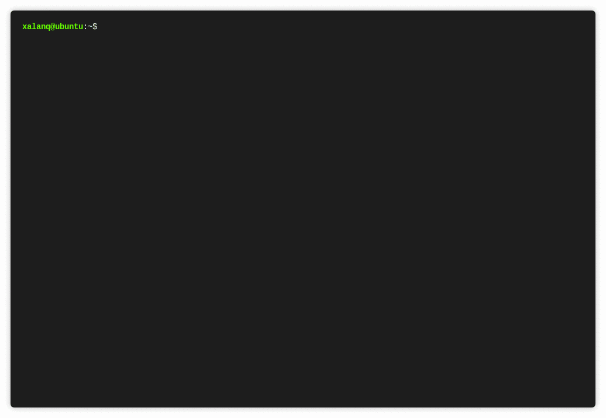

# Codeforces Tool

[](https://github.com/cys001x/cf-tool-x/releases)
[](https://github.com/cys001x/cf-tool-x/releases)
[](https://github.com/cys001x/cf-tool-x/actions/workflows/build.yml)
[](https://goreportcard.com/report/github.com/cys001x/cf-tool-x)
[](https://go.dev)
[](https://github.com/cys001x/cf-tool-x/blob/main/LICENSE)

Codeforces Tool 是 [Codeforces](https://codeforces.com) 的命令行界面的工具。

这玩意儿挺快、挺小、挺强大，还跨平台哦。

[安装](#安装) | [使用方法](#使用方法) | [命令文档](./docs/commands.md) | [常见问题](#常见问题) | [English](./README.md)

## 特点

* 支持 Contests、Gym、Groups 和 acmsguru
* 支持 Codeforces 中的所有编程语言
* 提交代码
* 动态刷新提交后的情况
* 拉取问题的样例
* 一条命令同步比赛或题目：样例、题面和最新提交代码
* 全局计时器：为比赛或题目计时，并记录每个时间节点
* 用 SQL 查询计时数据、统计总用时和按日期统计完成题数
* 从本地记录或 Codeforces 题库随机生成练习集
* 本地编译和测试样例
* 拉取某人的所有代码
* 从指定模板生成代码（包括时间戳，作者等信息）
* 列出某场比赛的所有题目的整体信息
* 列出最近 20 场比赛的链接和 div 等级
* 用默认的网页浏览器打开题目页面、榜单、提交页面等
* 设置网络代理，设置镜像站
* 丰富多彩的命令行

欢迎大家一起完善这个工具呀，欢迎Pull requests。



## 安装

你可以从[这里](https://github.com/cys001x/cf-tool-x/releases)直接下载一个可执行文件。

然后就能直接用啦~

或者你可以把整个 repo 给 clone 下来，然后自己编译 (go >= 1.26)：

```plain
$ git clone https://github.com/cys001x/cf-tool-x.git
$ cd cf-tool-x
$ go build -ldflags "-s -w" cf.go
```

如果你使用 Go module proxy 且该仓库为私有，可以让 Go 直接拉取：

```plain
$ go env -w GOPRIVATE=github.com/cys001x/cf-tool-x
```

## 使用方法

完整的命令参考见 [docs/commands.md](./docs/commands.md)。

以下简单模拟一场比赛的流程。

 `cf race 1136` 或者 `cf race https://codeforces.com/contest/1136`

就开始打 1136 这场比赛了！

如果比赛还未开始，则该命令会进行倒计时。比赛已开始或倒计时完后，工具会自动用默认浏览器打开比赛的题目界面与所有题目页面，并拉取样例到本地。

 `cf sync 1136` 或者 `cf sync 1136a`

一条命令同步整场比赛或单道题目：拉取样例和题面，拉取你最新的一次提交代码；如果没有提交且本地没有代码，则用默认模板生成代码。若本地已有代码，会先询问是否覆盖。

 `cf timer`

打开全局计时器。每秒在同一行刷新已用时间。输入 `start <specifier> <描述>` 开始为一道题目或一场
比赛计时，`end <specifier> <描述>` 结束，`pause` 暂停或继续，`q`（或 `exit`）关闭计时并输出总结。这些
命令也可以在其它终端执行。没有后台守护进程：计时依据 `~/.cf/timer.json` 中的时间戳计算。

计时器打开时，还可以直接输入其它 cf 命令（省去 `cf`，例如 `submit 1136a`）。命令在计时器下方
执行，执行完继续计时，不用退出再重新打开；`timer` 本身不能在计时器里再执行。按 Enter 空行只刷新
计时行，Ctrl-C 或 Ctrl-D 离开计时器并让它继续在后台计时。

可以同时为多道题目计时，`end` 关闭与 specifier 对应的那一个。`cf test` 全部样例通过时自动记录 `test` 节点，`cf submit` 自动记录 `submit` 节点（含判定结果）。
判定为 Accepted 时会询问是否关闭计时器，选是后再让用户提供一段总结。时间节点保存在
`<题目>/count_time.json`，全局单例状态保存在 `~/.cf/timer.json`。`end` 的描述或 `q`
时输入的总结会写入对应题目记录的 `summary` 字段。

 `cf db sync`

建立本地 SQLite 索引，并从 Codeforces API 补全比赛信息。`cf db time 1136a` 输出一道题的
时间节点和总用时；`cf db time 1136` 输出一场比赛里每道题的用时。`cf db stats --from
2026-01-01 --to 2026-06-30` 统计该时间段内完成的题数，并给出按天分布；加 `--accepted`
只统计判定为 Accepted 的题目。`cf db sql "SELECT ..."` 对 `~/.cf/timer.db` 执行只读
SQL，加 `--write` 才允许修改数据。每道题还会根据事件推导出单一状态标签
（`pending`、`open`、`done`、`tests_passed`、`accepted`）；在 practice 计时
（`cf timer s p_<set> <题目>`）中再次 Accepted，会依次变成 `practice_1`、
`practice_2`，最高 `practice_9`。`cf db stats --status done` 可以按状态过滤。

 `cf lpractice 5`

从本地计时数据库随机抽 5 道题，生成到 `cf/practice/<时间戳>-practice` 下。每题包含样例、
`statement.md` 和用默认模板生成的代码文件。`cf lrepractice` 只抽 Accepted（含 `practice_N`）的题，
`cf lnrepractice` 只抽从未计时过的题。第二个参数可以指定文件夹名，例如`cf lpractice 5 drill`。`cf opractice 5 --difficulty 1200-1600 --tags dp,greedy`
则从 Codeforces 在线题库中抽取。用 `cf timer s p_drill 1136a "retry"` 开始练习计时，
这次计时中的 Accepted 会推进该题的 practice 标签。

练习题目也可以写成单个 specifier：`p_<set>_<题目>`。例如 `cf submit p_drill_1136a`
提交 `cf/practice/drill/1136a` 中的代码，`cf test p_drill_1136a` 测试该目录，
`cf timer s p_drill_1136a` 开始练习计时。它必须是命令中唯一的 specifier。
题目部分是练习目录名（`1136a`、`100001a`），所以练习集名字可以带下划线
（`p_drill_easy_1136a`）。

 `cd ./cf/contest/1136/a` （或者是其他的路径，请看屏幕前的提示）

进入 A 题的目录，此时该目录下会包含该题的样例。

 `cf gen` 

用默认模板生成一份代码，代码文件名默认是题目的 ID。同目录下会创建一个空的 `analysis.md`。

 `vim a.cpp` 

用 Vim 写代码（这取决于你）。

 `cf test` 

编译并测试样例。

 `cf submit` 

提交代码。

 `cf list` 

查看当前比赛各个题目的信息。

 `cf ncontests`

列出最近 20 场已结束比赛的链接、div 等级和名字。

 `cf stand` 

用浏览器打开榜单，查看排名。

```plain
首先你得用 "cf config" 命令来配置一下用户名、密码和代码模板。

如果你想用本工具打比赛，那么最好用 "cf race" 命令。

支持的命令:
  cf config
  cf submit [-f <file>] [<specifier>...]
  cf list [<specifier>...]
  cf ncontests
  cf parse [<specifier>...]
  cf gen [<alias>]
  cf test [-f <file>] [-d <dir>] [<specifier>...]
  cf watch [all] [<specifier>...]
  cf open [<specifier>...]
  cf stand [<specifier>...]
  cf sid [<specifier>...]
  cf detail [<specifier>...]
  cf race [<specifier>...]
  cf pull [ac] [<specifier>...]
  cf sync [<specifier>...]
  cf timer [<args>...]
  cf db [options] [<args>...]
  cf lpractice [options] <count> [<name>]
  cf lrepractice [options] <count> [<name>]
  cf lnrepractice [options] <count> [<name>]
  cf opractice [options] <count> [<name>]
  cf clone [ac] [<handle>]
  cf statement [<specifier>...] [-d <dir>] [-f <file>]
  cf material [<specifier>...] [-d <dir>] [-f <file>]
  cf completion [<shell>]
  cf upgrade

参数:
  -h --help            帮助。
  --version            显示版本。
  -f <file>, --file <file>, <file>
                       文件的路径，例如 "a.cpp"、"./temp/a.cpp"
                       文件下载名
  -d <dir>, --dir <dir>
                       样例文件所在目录路径，用于 cf test。
                       文件下载路径
  <specifier>          任何有用的文本，例如
                       "https://codeforces.com/contest/100"、
                       "https://codeforces.com/contest/180/problem/A"、
                       "https://codeforces.com/group/Cw4JRyRGXR/contest/269760"、
                       "1111A"、"1111"、"a"、"Cw4JRyRGXR"。
                       "p_drill_1136a" 表示 "{cf}/practice/drill" 中的题目
                       1136a（由 "cf lpractice"/"cf opractice" 生成的练习集）。
                       你可以任意组合多个 <specifier> 来说明你的需求。
  <alias>              模板的名字，比如 "cpp"。
  <shell>              生成补全脚本的 shell：bash、zsh 或 fish。
  <args>               计时器命令（start/end/pause/q/status，可简写为 s/e/p/q）与参数；
                       或 cf db 的子命令（sql/time/stats/sync/path）与参数。
  ac                   是否只获取 Accpeted 的代码。
  --from <date>        "cf db stats" 的起始日期（YYYY-MM-DD）。
  --to <date>          "cf db stats" 的结束日期（YYYY-MM-DD）。
  --status <status>    "cf db stats" 只保留 pending/open/done/tests_passed/accepted/practice_N。
  --accepted           "cf db stats" 只统计 Accepted 的题目。
  --refresh            "cf db sync" 重新拉取比赛信息。
  --write              允许 "cf db sql" 修改数据。
  -j, --json           "cf db" 输出 JSON。
  --difficulty <range> "cf opractice" 的难度，例如 "1200" 或 "800-1200"。
  --tags <tags>        "cf opractice" 的标签，逗号分隔。
  <count>              练习集的题目数量。
  <name>               练习文件夹名，默认 "<时间戳>-practice"。

例子:
  cf config            配置 cf-tool。
  cf submit            cf 会自动检测你需要提交的文件。
  cf submit -f a.cpp
  cf submit https://codeforces.com/contest/100/A
  cf submit -f a.cpp 100A 
  cf submit -f a.cpp 100 a
  cf submit contest 100 a
  cf submit gym 100001 a
  cf list              列出当前比赛的题目通过、时限等信息。
  cf list 1119         
  cf ncontests         列出最近 20 场已结束比赛的链接、div 等级和名字。
  cf parse 100         获取 contest 100 的所有题目的样例到文件夹
                       "{cf}/{contest}/100/<题目>" 中。
  cf parse gym 100001a
                       获取 gym 100001 的 a 题的样例到文件夹
                       "{cf}/{gym}/100001/a" 中。
  cf parse gym 100001
                       获取 gym 100001 的所有题目的样例到文件夹
                       "{cf}/{gym}/100001" 中。
  cf parse             获取当前比赛的当前题目到当前文件夹下。
  cf gen               用默认的模板生成一份代码到当前文件夹下，并创建空的 analysis.md。
  cf gen cpp           用名字为 "cpp" 的模板来生成一份代码到当前文件夹下。
  cf test              在当前目录下执行模板里的命令，并测试全部样例。如果你想加一组新的测试数据，
                       新建两个文件 "inK.txt" 和 "ansK.txt" 即可，其中 K 是包含 0~9 的字符串。
  cf test -f a.cpp -d ./1a
                       用 ./1a 目录下的样例文件测试 a.cpp。
  cf watch             查看自己在当前比赛的最后 10 次提交结果。
  cf watch all         查看自己在当前比赛的全部提交结果
  cf open 1136a        用默认的浏览器打开比赛 contest 1136, problem a.
  cf open gym 100136   用默认的浏览器打开比赛 gym 100136.
  cf stand             用默认的浏览器打开当前比赛的榜单。
  cf sid 52531875      用默认的浏览器打开 52531875 这个提交页面。
  cf sid               打开最后一次提交的页面。
  cf detail https://codeforces.com/contest/1136/submission/52531875
                       打印该提交的概要信息与每个测试点的结果，失败测试点会附上
                       输入、输出与期望答案。
  cf detail            打印最后一次提交的详情。
  cf submit 1136a      提交后立刻打印提交链接；若判定不是 Accepted，会打印失败的
                       测试点并存成 inK.txt/ansK.txt，可直接用 cf test 本地复现。
  cf race 1136         如果比赛还未开始且进入倒计时，则该命令会倒计时。倒计时完后，会自动打开一些
                       题目页面并拉取样例。
  cf pull 100          拉取比赛 100 中你的全部提交，保存到 "./<题目>/<题目>.<后缀>"。
  cf pull 100 a        拉取比赛 100 题目 a 的全部提交，保存到 "./a.<后缀>"。
  cf pull ac 100 a     拉取比赛 id 为 100 的题目 a 的 AC 代码。
  cf pull              拉取当前题目的全部提交到当前文件夹下。
  cf sync 1136         同步比赛 1136 的所有题目：拉取样例和题面，拉取每题最新提交；
                       没有提交且本地没有代码时用默认模板生成。
  cf sync 1136a        同步比赛 1136 的题目 a。
  cf sync              同步当前题目。
  cf timer             在前台打开计时器，每秒刷新一行已用时间。
                       计时器打开时可以直接输入其它 cf 命令（省去 "cf"），
                       例如 "submit 1136a"，命令在计时器下方执行，计时器
                       不关闭。
  cf timer start 1136a "read the problem"
                       开始为比赛 1136 的题目 a 计时。
  cf timer end 1136a "solved"
                       结束当前题目，必须与 start 的题目一致。
  cf timer pause       暂停或继续计时。
  cf timer q "contest done"
                       关闭计时器并输出总结。
  cf timer s p_drill 1136a "practice"
                       在 "{cf}/practice/drill" 中为题目 1136a 开始练习计时；
                       这次计时中的 Accepted 会推进 practice 标签。
                       "p_drill_1136a" 也可以代替 "p_drill 1136a"。
  submit 1136a         （在计时器中）执行 "cf submit 1136a"，不用退出计时器。
                       除 "timer" 外的所有 cf 命令都可以这样用；输入 "q"
                       关闭计时器。
  cf submit p_drill_1136a
                       提交 "{cf}/practice/drill" 中练习题 1136a 的代码。
                       "p_<set>_<题目>" 可用于所有接受 specifier 的命令，
                       在 "cf timer start/end" 中则开始一次练习计时。
  cf db sync           把所有 "count_time.json" 索引进 "~/.cf/timer.db"，
                       并从 Codeforces API 补全比赛信息。
  cf db time 1136a     输出一道题的时间节点与总用时。
  cf db time 1136      输出一场比赛中每道题的用时、合计与跨度。
  cf db stats --from 2026-01-01 --to 2026-06-30
                       统计该时间段内完成的题数。
  cf db stats --accepted --from 2026-01-01
                       只统计判定为 Accepted 的已完成题目。
  cf db stats --status done --from 2026-01-01
                       只统计状态为 done 的题目。
  cf db sql "SELECT type, COUNT(*) FROM event GROUP BY type"
                       执行只读 SQL；加 --write 才允许修改数据。
  cf lpractice 5       从本地计时数据库随机抽 5 道题。
  cf lrepractice 5     从本地数据库随机抽 5 道 Accepted 的题。
  cf lnrepractice 5    从本地数据库随机抽 5 道从未计时过的题。
  cf opractice 5 --difficulty 1200-1600 --tags dp,greedy
                       从 Codeforces 题库随机抽 5 道题。
  cf lpractice 5 drill 练习集放到 "cf/practice/drill"。
  cf clone xalanq      拉取 xalanq 的所有提交代码。
  cf upgrade           从 GitHub 更新 "cf" 到最新版。
  cf statement         拉取当前题目的题面到当前文件夹下。
  cf statement 1136a   拉取比赛 1136 题目 a 的题面。
  cf statement 1136    拉取比赛 1136 所有题目的题面。
  cf material 1136     拉取比赛 1136 的所有比赛资料（公告、题解等）并保存为 .md 文件。
  cf completion bash   输出 bash 补全脚本，用 "source <(cf completion bash)" 加载。
  cf completion zsh    输出 zsh 补全脚本，在 ~/.zshrc 里用
                       "eval \"$(cf completion zsh)\"" 加载。
  cf completion fish   输出 fish 补全脚本，保存到
                       "~/.config/fish/completions/cf.fish"。

储存的文件:
  cf 会保存数据到以下文件：

  "~/.cf/config"        这是配置文件，包括模版等信息。
  "~/.cf/session"       这是会话文件，包括 cookies、用户名、密码等。
  "~/.cf/timer.json"    全局计时器的状态。
  "~/.cf/timer.db"      计时记录对应的本地 SQLite 索引。
  "<题目>/count_time.json"
                        "cf timer" 写入的计时数据。
  "{cf}/practice/<name>"
                        "cf lpractice" 和 "cf opractice" 生成的练习集。

  "~" 这个符号是系统当前用户的主文件夹。

模板:
  你可以在你的代码里插入一些标识符，当用 cf 生成代码的时候，标识符会按照以下规则替换：

  $%U%$   用户名 (例如 xalanq)
  $%Y%$   年  (例如 2019)
  $%M%$   月  (例如 04)
  $%D%$   日  (例如 09)
  $%h%$   时  (例如 08)
  $%m%$   分  (例如 05)
  $%s%$   秒  (例如 00)

模板内的脚本:
  模板支持三个脚本命令，当使用 "cf test" 时会依次执行：
    - before_script   (只会执行一次)
    - script          (有多少个样例就会执行多少次)
    - after_script    (只会执行一次)
  "before_script" 或者 "after_script" 你可以根据需要来设置，也可以设置为空。
  在 "script" 里你必须要运行你的程序，通过标准 IO 来输入/输出数据（不用重定向）。

  你在这些脚本命令里也能插入一些标识符，这些标识符会按照以下规则替换：
  
  $%path%$   代码的路径 (不包括 $%full%$， 比如 "/home/xalanq/")
  $%full%$   代码的文件名 (比如 "a.cpp")
  $%file%$   代码的文件名 (不包括后缀，比如 "a")
  $%rand%$   一个长度为 8 的随机字符串 (只包括 "a-z" "0-9" 范围内的字符)
```

## 模板例子

当这份模板被 `cf gen` 生成时，模板内部的占位符会替换成相应的内容。

```
$%U%$   用户名 (例如 xalanq)
$%Y%$   年  (例如 2019)
$%M%$   月  (例如 04)
$%D%$   日  (例如 09)
$%h%$   时  (例如 08)
$%m%$   分  (例如 05)
$%s%$   秒  (例如 00)
```

```cpp
/* Generated by powerful Codeforces Tool
 * You can download the binary file in here https://github.com/cys001x/cf-tool-x/releases (Windows, macOS, Linux)
 * Author: $%U%$
 * Time: $%Y%$-$%M%$-$%D%$ $%h%$:$%m%$:$%s%$
**/

#include <bits/stdc++.h>
using namespace std;

typedef long long ll;

int main() {
    ios::sync_with_stdio(false);
    cin.tie(0);
    
    return 0;
}
```

## 常见问题

### 我双击了这个程序但是没啥效果

Codeforces Tool 是命令行界面的工具，你应该在终端里运行这个工具。

### 我无法使用 `cf` 这个命令

你应该将 `cf` 这个程序放到一个已经加入到系统变量 PATH 的路径里 (比如说 Linux 里的 `/usr/bin/` )。

或者你直接去搜 "怎样添加路径到系统变量 PATH"。

### 如何加一个新的测试数据

新建两个额外的测试数据文件 `inK.txt` 和 `ansK.txt` （K 是包含 0~9 的字符串）。

### 在终端里启用 tab 补全命令

`cf` 可以直接输出补全脚本：

```plain
# bash：加入 ~/.bashrc
$ source <(cf completion bash)

# zsh：加入 ~/.zshrc
$ eval "$(cf completion zsh)"

# fish
$ cf completion fish > ~/.config/fish/completions/cf.fish
```

重新加载 shell 后，输入 `cf sta<Tab>` 会补全成 `cf stand`。zsh-autosuggestions
或 fish 自带的行内提示也会复用这套补全定义，在输入时显示灰色建议。
